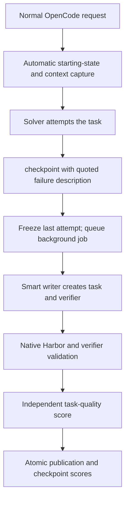
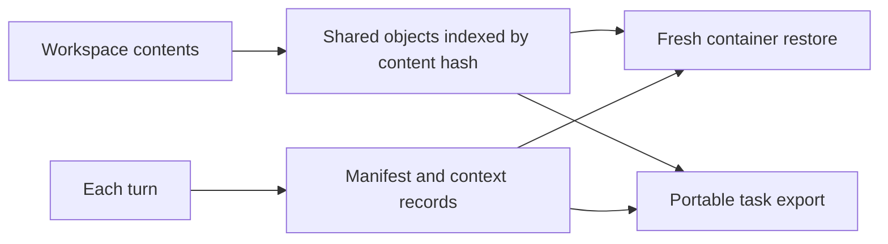
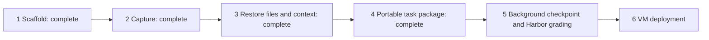
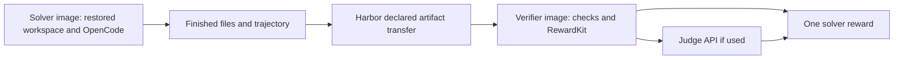

# MVP design

## Purpose and status

Create reproducible reinforcement learning (RL) task candidates from model attempts on normal software tasks. OpenCode is the interactive agent. The harness captures state, restores it, packages it, and checks that the agent can run. OpenRouter provides model access.

**Current position:** Steps 1-4 are complete with passing evidence. Step 5 is next: background checkpoint creation with smart task writing, native Harbor execution, RewardKit grading, and independent task-quality review. The agreed boundary is: Step 3 restores and compares; Step 4 packages for portability; Step 5 connects the user command, task generation, grading and quality review.

The first application is a quality audit of Xiaomi's public MiMo-V2.6 RL task dataset. Capturing that software work can produce additional task candidates. [Dataset](https://huggingface.co/datasets/XiaomiMiMo/MiMo-V2.6-RL-oss)

A working environment is not proof of a correct RL reward. A captured task remains a candidate until its task-specific success check is validated.

This document is editable. Use short, precise technical English. Detailed evidence belongs in the append-only agent-log.md. Requirement documents define each step's completion gate; this document explains the workflow.

## Normal use



In OpenCode, use `!checkpoint "The agent did not do x"`. The shell command accepts a string, prints the queued task ID and returns. No interactive review is required. Keep the current last-attempt selection and active-session identity rules. Later work cannot change the frozen task. Background jobs continue after OpenCode closes.

The starting workspace and prior context define the retry. The original attempt's response and tools are evidence, outside active replay context. Use `checkpoint scores` to see task-quality scores, FAILED or RUNNING.

## Storage and isolation



Unchanged file contents reuse stored objects. New or changed contents add objects. Manifests preserve paths, file types, permissions, and link targets. Context and effective request records preserve the selected input. Storage grows with unique changes and retained context; there is no automatic deletion policy.

Each restore has a private writable workspace and OpenCode session store. The source capture store is read-only. Never use the live host workspace as the retry workspace.

The MVP covers one idle OpenCode session and one declared coding workspace. Process memory, live browser state, external service state, queued turns, and simultaneous sessions need separate capture rules.

## Build steps



| Step | Single output | Completion proof |
|---|---|---|
| 1 — Scaffold | Repository and capture test contract | Dependencies, fixture, version evidence, and test entry point exist. |
| 2 — Capture | Identified starting checkpoints | Frozen R1–R6 pass; real OpenCode capture and the optional live case have evidence. |
| 3 — Restore | Restore command and comparison reports | Two fresh containers reproduce the full workspace and effective input; negative fixtures fail. |
| 4 — Package | Portable task folder in the agreed layout | The folder contains all required data and restores without the original store. |
| 5 — User command | Background Harbor task generation and grading | One command freezes the last attempt, creates and validates a task/verifier, and publishes an independent quality score. |
| 6 — Deploy | Verified VM installation | The same workflow passes from a clean checkout on the selected VM. |

### Step 3 — Restore files and context

Use the existing capture store. Validate the selected checkpoint. Start a pinned Linux container and restore its files and prior conversation. Submit the selected request once. Intercept the first regenerated primary model request without forwarding it.

Check the complete restored workspace tree: required directories/files, bytes, permissions, link targets, and absence of deleted or unexpected entries. Compare instructions, ordered context, tool schemas, model settings, and declared path mappings. Restore twice to prove isolation. Invalid or incomplete state must fail clearly.

**Output:** a restore command, a pinned runtime definition, and structured comparison reports. No portable task package or live inference is required here.

**Requirements:** [Step 3](docs/step-3-requirements.md).

### Step 4 — Package the saved state

Put the selected saved state into a Harbor-shaped task folder. Include the objects, context, pinned environment references, and adapter metadata needed elsewhere. Validate the folder structure and object inventory.

Use Step 3's restore command to check the exported folder from a separate location with no access to the original store. Do not build a second restore implementation.

**Output:** a portable task candidate. This step does not connect !checkpoint or make live model calls.

**Requirements:** [Step 4](docs/step-4-requirements.md).

### Step 5 — Background checkpoint, task writing and grading

Reuse capture, export and restore. A smart writer uses the selected capture and failure description to create task instructions and success criteria. Support script checks, a model rubric, or both through RewardKit. A separate agent scores task quality against the agreed universal rubric after the writer finishes.

Run native Harbor before marking the task READY. Validate known good/bad results. A separate verifier container receives the finished workspace and trajectory, runs grading and emits one numeric solver reward. A grading error is not a solver reward of zero.

The task-quality rubric covers instructions, starting state/context, intent alignment, result/behaviour coverage, known good/bad grading and native execution. Its score is separate from solver reward. No human approval gate or minimum score threshold was agreed.

**Requirements and exact interface references:** [Step 5](docs/step-5-requirements.md).

### Step 6 — Deploy

Document clean installation. Select a VM with the user. Keep provisioning separate from capture logic. Run the same capture, package, restore, and live-tool fixture there before the dataset audit starts.

**Output:** installation instructions and remote acceptance evidence. Freeze the provider-specific requirements before this step begins. Scripted batches follow deployment; start with 10–20 trials before increasing concurrency.

## Step 5 storage and environments

```text
output/
  tasks/<task-id>/
    instruction.md
    task.toml
    environment/Dockerfile
    tests/                 # Dedicated verifier Dockerfile, checks and rubric
    capture/
    evidence/
    images.lock.json
  jobs/<job-id>/            # Progress, quality score, logs and diagnostics
```

Images reside in Docker's image store; packages lock their identities. Registry digests are used when publishing images. Configuration specifies workspace/output directories, writer/reviewer/judge models, credential variable names, limits and the quality rubric. The harness runs beside OpenCode on a VM or another supported host.



Keep rubric, reference answers and judge credentials outside the solver. Test access restrictions. The verifier starts its own application instance if required; live process state is not transferred. Restore saved conversation context, not just the task instruction.

Step 4 proved portable capture export. Step 5 adds native Harbor compatibility; folder names alone do not establish it. Use the [Harbor task format](https://docs.harborframework.com/tasks/overview), [separate verifier and artifact transfer](https://docs.harborframework.com/tasks/separate-verifier), and [RewardKit judge interface](https://docs.harborframework.com/rewardkit/judge-criteria). Detailed file and API references are in the Step 5 requirements.

## Rules for implementation and review

1. Read this design, the current step's requirements, and the agent-log rules.
2. Execute only the requested step. For “next step”, use the current verified handoff. Do not restart completed steps.
3. Reuse the previous step's implementation and tests. Do not duplicate restore or comparison logic.
4. Each requirement has evidence and a completion result. A finding blocks completion only if it violates that step's stated requirement. New requirements need user approval.
5. Use isolated fixtures and project configuration. Do not inspect personal sessions or change global OpenCode settings.
6. Never store credentials in Git, reports, or task packages. Keep generated data under ignored work/.
7. Use real OpenCode and real containers for required integration evidence. Unit tests and controlled provider responses supplement that evidence.
8. Missing prerequisites are BLOCKED, not PASS. Preserve evidence; append verified results and citations to agent-log.md.
9. End with a short status, evidence location, and next step. A passing test count alone does not establish completion.

## Model-spend budgets

Step 5 has a $0.20 aggregate model-spend cap per checkpoint: generation, independent review, validation judge calls and retries. Later solver runs and grading use a separate runtime budget. VM/container compute is separate. The existing optional live-capture test retains its separate $0.10 key-limit contract; this edit does not change test code.
