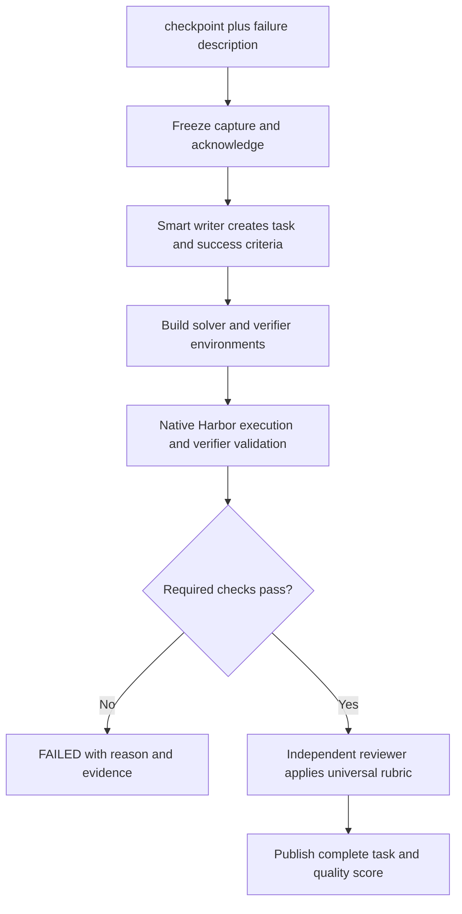
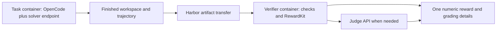

# Step 5 — Background checkpoint creation and Harbor grading

## Goal and scope

Turn the last captured attempt and a short user failure description into a runnable Harbor task with task-specific success criteria. Use a smart writer agent, native Harbor execution, RewardKit grading, and a separate independent task-quality reviewer. This document records the user-approved Step 5 design from the planning conversation on 2026-10-17. These are requirements, not claims of implemented behaviour.

Reuse Step 4 export and Step 3 restore. Keep current last-attempt selection. Do not add earlier-turn selection features for this step. VM provisioning, batch scheduling, RL training, and inference weight switching remain outside this step.

## User interface

OpenCode's `!` invokes a shell command; it does not supply an interactive terminal. The command accepts the user's description as a quoted string:

```bash
checkpoint "The agent did not do x"
checkpoint scores
```

In OpenCode the first command is entered with `!` in front. Do not prompt interactively or require human approval. The description tells the writer what went wrong and what the user intended.

Select the last attempt using existing active-session identity rules. Freeze its saved starting workspace, preceding conversation, effective request, and original-attempt evidence. Exclude the command itself. Later messages and live file edits must not change the selected input or exported task.

Print a short script-generated acknowledgement and return promptly:

```text
QUEUED <task-id>
```

The background job must continue if OpenCode or the launching terminal closes. Persist job progress and report failures clearly after a crash. Do not require the user to keep a conversation open.

## Configuration and storage

The harness runs beside the OpenCode server on a VM or another supported host. The user's ordinary project can be any coding task; the open-source RL-task audit is only one use case. Avoid machine-specific paths.

Provide a system configuration file containing:

- Workspace directory and output directory.
- Writer, independent reviewer, and runtime judge models and settings.
- Runtime credential environment-variable names; never stored secret values.
- Per-checkpoint model-spend cap, timeouts, and retry limits.
- The versioned universal task-quality rubric.

```text
output/
  tasks/<task-id>/   # Complete published Harbor task packages
  jobs/<job-id>/    # Status, scores, logs, failed-build evidence
```

Task packages contain instructions, native task configuration, saved capture data, grading files, and immutable image references. Images reside in Docker's image store, not repeated image tarballs inside task folders. Lock local image IDs; record registry digests when published. Task-ID tags are convenience names, not the immutable identity. Registry publication is a later shipping option, not required provisioning in Step 5.

Publish complete tasks atomically. Keep incomplete output and diagnostics under jobs, outside the completed-task directory.

## Background workflow



The writer uses the frozen context and user description to define instructions and task-specific pass/fail checks, a model rubric, or both. The independent reviewer runs after the writer completes and inspects the task, verifier, and validation evidence. Its quality score is separate from the reward a solver earns.

## Native interfaces and exact references

Use Harbor task and RewardKit interfaces, not a private equivalent. Select and pin compatible released versions, then record those versions and version-specific source references in the implementation documentation and runtime locks. The links below are exact upstream entry points, not version pins. Verify behaviour against the selected releases; current documentation is not proof that an installed release supports it.

| Interface | Primary reference | Implementation use |
|---|---|---|
| Task layout | https://docs.harborframework.com/tasks/overview | `instruction.md`, `task.toml`, environment and tests directories. |
| Native task configuration | https://docs.harborframework.com/tasks/configuration | Follow the upstream schema rather than the Step 4 custom descriptor alone. |
| Configuration source | https://github.com/harbor-framework/harbor/blob/main/src/harbor/models/task/config.py | Resolve exact fields/types for the pinned release. |
| Separate verifier | https://docs.harborframework.com/tasks/separate-verifier | `[verifier] environment_mode = "separate"`, verifier image selection, artifact transfer. |
| Artifacts | https://docs.harborframework.com/tasks/artifacts | Declare finished workspace and trajectory transfer. |
| Verifier contract | https://docs.harborframework.com/tasks/verifier | `/tests/test.sh` entry point and `/logs/verifier/` reward outputs. |
| RewardKit setup | https://docs.harborframework.com/rewardkit/quick-start | Run deterministic checks and grading through RewardKit. |
| Model judge and rubric | https://docs.harborframework.com/rewardkit/judge-criteria | Judge model, input files, criterion types, weights and scoring. |
| RewardKit examples | https://github.com/harbor-framework/harbor/blob/main/skills/rewardkit/SKILL.md | `checks.py`, `judge.toml`, `reward.toml`, entry-point examples and detailed results. |
| Agent integration | https://docs.harborframework.com/agents/custom-agents | Integrate restored OpenCode execution with Harbor if the built-in path cannot preserve the captured input. |
| Trajectory interface | https://docs.harborframework.com/agents/atif | Use Harbor's trajectory interface where required; verify the chosen adapter emits it. |

The implementation must demonstrate an actual Harbor run. Folder names and our own restore command alone do not prove native compatibility.

## Solver and verifier environments



The solver image contains the starting workspace and task dependencies. OpenCode executes tools and calls the configured solver inference endpoint. Restore the captured preceding context and submit the selected request; a fresh instruction by itself is insufficient. Retain model/version identity. Loading training weights belongs to the external inference server, not the task image.

The separate verifier image contains grading dependencies, checks and rubric, not judge model weights. The judge is called through its configured API. Inject judge credentials at verification runtime. The solver must not receive those credentials, hidden rubric, reference answers, verifier filesystem, task-package host directory, or Docker socket. Test isolation explicitly.

Use `environment/Dockerfile` for the solver and `tests/Dockerfile` for the dedicated verifier. The verifier image must supply `/tests/test.sh`; do not assume Harbor will upload tests into a dedicated verifier image. [Separate verifier: image selection and dedicated verifier image](https://docs.harborframework.com/tasks/separate-verifier#image-selection).

Declare the complete project workspace and execution trajectory as grading inputs, subject to credential exclusion. Harbor transfers declared artifacts to their source paths in the verifier. Agent logs are not implicitly transferred: declare the trajectory explicitly. [Artifact transfer](https://docs.harborframework.com/tasks/separate-verifier#artifact-transfer).

Grade finished files and required behaviour in the trajectory. The final report is supporting evidence only. If grading needs an application, start a separate instance from the finished files; do not assume live process state transfers.

## Grading files, reward and failures

```text
<task-id>/
  instruction.md
  task.toml
  environment/Dockerfile
  tests/
    Dockerfile
    test.sh
    checks.py       # When programmatic checks are used
    judge.toml      # When a model judge is used
    reward.toml     # Score aggregation
  capture/
  evidence/         # Original failed attempt, outside solver replay context
  images.lock.json
```

Use the pinned RewardKit schemas. `test.sh` starts RewardKit; Python criteria implement deterministic checks; judge TOML specifies model, files, rubric and weights. Define aggregation into one numeric solver reward in the range 0–1. Keep criterion details separately. See the upstream RewardKit setup and judge references above.

Write through Harbor's native reward-file interface. Record the judge model, settings, prompt/rubric and RewardKit version. Judge timeout, API failure, invalid response or infrastructure failure is grading ERROR, never silently solver reward 0. Use existing Harbor/RewardKit failure and budget controls where they meet these contracts; verify their behaviour in the pinned versions.

Validate the task before calling it READY: test known correct and incorrect results and run native Harbor. The smoke solver need not solve the task; execution must work and grading must distinguish tested good/bad outcomes. Preserve evidence rather than claiming that generating a checker makes it validated.

## Universal task-quality rubric

Use one versioned rubric across tasks. The independent reviewer returns one quality score out of 100 plus a breakdown for:

1. Clear instructions.
2. Correct starting state and sufficient context.
3. Success criteria match the user's intent.
4. Grading covers results and required behaviour.
5. Known correct and incorrect examples receive appropriate scores.
6. Native Harbor execution works.

These dimensions were agreed; numerical weights were not specified. Document the weights used. No minimum score threshold or interactive approval gate was agreed. A review score does not replace execution and verifier-validation evidence.

## Cost and status

The total model-spend cap is **$0.20 per checkpoint**, covering generation, independent review, validation judge calls and retries. Enforce bounded calls and account for outstanding requests before admitting more spend. Stop with a clear failure if the cap cannot be respected. Never silently exceed the limit or fall back to a more expensive model. Credentials are supplied only at runtime.

Ordinary later solver attempts and their grading use a separate runtime budget. VM/container compute is separate from the checkpoint model-spend cap. The old $0.10 live-capture test cap remains a separate existing test contract; it is not this checkpoint cap.

```text
$ checkpoint scores
task-001  87/100
task-002  FAILED
task-003  RUNNING
```

Print FAILED for required package, Harbor or grading-validation failures; retain the precise reason and evidence. Completed score lines show the independent task-quality score, not solver rewards. Format acknowledgements and status with deterministic code, not model prose.

## Acceptance requirements

| ID | Requirement and evidence |
|---|---|
| S5-R1 | Quoted failure description, current last-attempt selection and prompt acknowledgement. Real OpenCode invocation selects the correct active-session attempt by identity. No interactive input. |
| S5-R2 | Background job survives OpenCode/terminal closure. Persist status and report process failures. Use an event-controlled test to prove later messages and edits cannot enter the selected task. |
| S5-R3 | Configurable workspace/output/models/credentials/limits; smart task writer and separate independent reviewer. Retain generated task-specific criteria and versioned universal quality score/breakdown. |
| S5-R4 | Native Harbor task runs with pinned interfaces, captured starting files/context and real OpenCode tool execution. Reuse prior exporter/restore logic. Test independent package execution. |
| S5-R5 | Dedicated solver/verifier images have immutable identities. Finished files and trajectory transfer correctly; solver cannot access hidden grading material or judge credentials. |
| S5-R6 | Deterministic and model-rubric paths produce one solver reward through RewardKit. Known correct/incorrect fixtures validate criteria. Judge/infrastructure errors are distinct from task failure. |
| S5-R7 | Enforce the $0.20 aggregate checkpoint model cap, timeouts and retry limits. Test exhaustion/error paths without secrets in output. Retain real-provider/tool evidence; keep paid live tests opt-in. |
| S5-R8 | Atomic completed-task publication; deterministic QUEUED/scores output; failed jobs retain diagnostics. No false READY status, no manual approval gate. |

## Completion gate and handoff

Demonstrate S5-R1–R8 with evidence, including real OpenCode, native Harbor, separate verifier and a bounded real-provider/tool workflow. Run appropriate existing regression suites. Distinguish mocked failure tests from actual integration evidence. Do not treat skipped or blocked checks as passing.

Use event/process-completion synchronization, not fixed sleeps. Append verified revision, commands, costs, pinned versions, image identities, evidence and remaining limitations to agent-log.md; never modify previous entries. Step 6 remains VM deployment, not part of this implementation.
